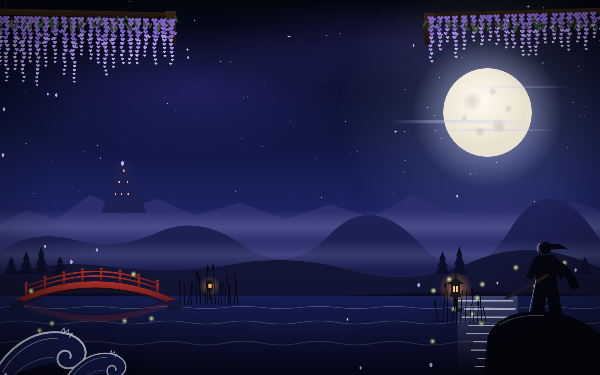
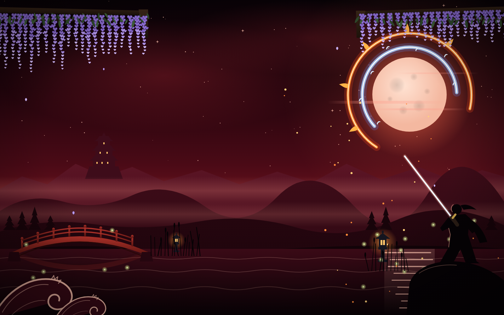

# Claude Code mods

[](https://github.com/nitingpt000/claude-mods/releases/latest) [](LICENSE)

**[Read the v1.0.0 release notes](https://github.com/nitingpt000/claude-mods/releases/latest)** for the full tour, screenshots included.

Animated backdrop themes for the Claude Code Desktop app, each showing at a glance whether Claude is working or waiting on you, plus seven side panels: [Session Diary](#-session-diary), [Security Watch](#%EF%B8%8F-security-watch), [Mission Scroll](#-mission-scroll), [Quick Actions](#-quick-actions), [Jutsu Scroll](#-jutsu-scroll), [File Heatmap](#-file-heatmap) and [Git Pulse](#-git-pulse).

The panels share one design: a heading, small rounded chips for the key figures, and rounded cards for the content. The text samples below show what each one holds.

## Themes

| Mod | While Claude works | When Claude needs you |
| --- | --- | --- |
| 🌸 **[Wisteria Moon](#-wisteria-moon)** |  |  |
| 🏴‍☠️ **[Grand Tide](#%EF%B8%8F-grand-tide)** |  |  |
| 🥷 **[Shinobi Dusk](#-shinobi-dusk)** |  |  |

All art is original vector drawing, animated with CSS only.

## Install

The themes need the Claude Code Desktop app, with a recent Claude Code in its Code tab; the terminal draws no theme. The side panels work everywhere, the terminal included.

At the prompt of a terminal session:

```
/plugin install wisteria-moon --marketplace nitingpt000/claude-mods
```

```
/plugin install grand-tide --marketplace nitingpt000/claude-mods
```

```
/plugin install shinobi-dusk --marketplace nitingpt000/claude-mods
```

```
/plugin install session-diary --marketplace nitingpt000/claude-mods
```

```
/plugin install security-watch --marketplace nitingpt000/claude-mods
```

```
/plugin install mission-scroll --marketplace nitingpt000/claude-mods
```

```
/plugin install quick-actions --marketplace nitingpt000/claude-mods
```

```
/plugin install file-heatmap --marketplace nitingpt000/claude-mods
```

```
/plugin install git-pulse --marketplace nitingpt000/claude-mods
```

```
/plugin install jutsu-scroll --marketplace nitingpt000/claude-mods
```

Answer `y` to add the marketplace, then pick a scope (user is the usual choice).

From a shell:

```sh
claude plugin install wisteria-moon --marketplace nitingpt000/claude-mods
claude plugin install grand-tide --marketplace nitingpt000/claude-mods
claude plugin install shinobi-dusk --marketplace nitingpt000/claude-mods
claude plugin install session-diary --marketplace nitingpt000/claude-mods
claude plugin install security-watch --marketplace nitingpt000/claude-mods
claude plugin install mission-scroll --marketplace nitingpt000/claude-mods
claude plugin install quick-actions --marketplace nitingpt000/claude-mods
claude plugin install file-heatmap --marketplace nitingpt000/claude-mods
claude plugin install git-pulse --marketplace nitingpt000/claude-mods
claude plugin install jutsu-scroll --marketplace nitingpt000/claude-mods
```

In the desktop app, where `/plugin` does not run: click **+** next to the prompt box, then **Plugins**, **Add marketplace** with `nitingpt000/claude-mods`, then **Add plugin**.

Then start a new local session in the Code tab and send a message: the scene comes up behind the chat.

**Keep one theme on at a time.** Each sets the backdrop when a session starts, so with several on you get whichever loads last. Switch with `claude plugin enable <mod>` and `claude plugin disable <mod>`. The side panels aren't themes, so they work alongside any of them and each other.

## 🌸 Wisteria Moon

A Taishō-era night by a river.

- **While Claude works:** wisteria hangs from wooden pergolas in both top corners, swaying and shedding petals. A castle keeps its lamps lit on the far ridge, mist drifts between the mountains, and a red arched bridge, stone lanterns, reeds and fireflies line the moonlit river. A lone swordsman keeps watch on a rock.
- **When Claude needs you:** the sky and river turn crimson, the swordsman raises his blade, and two crescent arcs, one of water and one of flame, sweep around the moon while embers rise. The arcs tilt differently each time.
- **Colors:** indigo-night surfaces with a wisteria-violet accent, dark mode only.

## 🏴‍☠️ Grand Tide

A galleon at sunset on the open sea.

- **While Claude works:** sun rays turn slowly behind clouds lit from below, a lighthouse sweeps its beam from a far cliff, waves roll in layers and sparkle along the sun's path, and gulls glide. A three-masted ship rides the swell under full sail, and a gull rests on old pier posts in the corner.
- **When Claude needs you:** the sky turns gold, the sails furl and gulls burst from the ship. A treasure map unrolls with islands, a sea serpent doodle, a turning compass rose and a dotted route to a glowing red X. The route is different each time.
- **Colors:** deep-sea navy surfaces with a sunset-gold accent, dark mode only.

## 🥷 Shinobi Dusk

A hidden ninja village at dusk.

- **While Claude works:** a full moon rises over a dusk sky, a five-tier pagoda and a village of curved rooftops with flickering windows, red paper lanterns swaying on a string, and leaves tumbling down. Now and then a shinobi leaps across the rooftops.
- **When Claude needs you:** the sky turns red and a glowing 忍 seal ignites in the upper right, ringed by two whirls of leaves turning in opposite directions. A shuriken flies in and strikes the ring, and the shinobi stands watch on the watchtower, scarf in the wind. The shuriken comes from a new angle each time.
- **Colors:** plum-black surfaces with an ember-orange accent, dark mode only.

## 📔 Session Diary

A side panel with a live timeline of everything Claude does in the session. It opens when a session starts; `/diary` opens it again.

```
12 calls · 4 edits · 6 commands · 1 failed
[ All ] [ Edits ] [ Commands ] [ Failures ] [ Clear ]

13:41:58  💬 Split the token logic into its own file
13:42:03    📄 Read     auth/session.ts                 ✔
13:42:05    ✏️ Edit     auth/token.ts      +48 −12       ✔
13:42:09    ▶ Bash      npm test                        ✔ 3.2s
13:42:15    ▶ Bash      git push                        ✘ failed 1.1s
13:42:20      ↳ 🤖 Agent  Review the diff                 … running
```

- Each prompt you send starts a new section. Automated prompts, such as a background task's notice, are left out.
- Every tool call shows its time, a kind icon (edit, command, read, search, web, agent, connector) and a short label: the command, the file, the pattern or the URL.
- Edits and writes show lines added and removed.
- Status is `… running` while it works, then ✔ (with its duration when over a second), ✘ **failed** in red, or ⊘ **denied** when you refused a permission.
- Calls made by a subagent are indented with ↳.
- Filter by **All**, **Edits**, **Commands** or **Failures**, and **Clear** to start fresh. The newest 400 entries are kept.
- Works in the terminal, the Desktop app, VS Code and mobile. It only watches: it never blocks or changes a call.

## 🛡️ Security Watch

A side panel that checks every tool call as it happens and lists the ones worth a look. It opens when a session starts; `/security` opens it again.

```
🔴 1 risky · 🟡 2 to review · 48 calls checked
[ All ] [ Risky ] [ Review ] [ Clear ]

14:02:11  🔴 Bash  git push -f origin main            ⊘ you refused it
                   force-pushes, rewriting remote history
14:03:40  🟡 Bash  npm install left-pad               ✔ ran
                   installs a package
14:05:02  🟡 Read  .ssh/id_ed25519                    ✔ ran
                   reads a file that usually holds secrets
```

**🔴 Risky**, also shown as a toast:
- deleting or discarding work: `rm -rf`, `Remove-Item -Recurse -Force`, `git push --force`, `git reset --hard`, `git clean -f`, `DROP TABLE`
- running a script downloaded from the internet: `curl … | bash`, `iwr … | iex`
- administrator rights, `chmod 777`, turning off Defender or the firewall, registry edits
- publishing a package: `npm publish` and the like
- writing what looks like an API key, token or private key into a file, or changing `.env`, key or credential files
- changing what runs when a shell, git or Claude Code starts: `.bashrc`, PowerShell profiles, `.git/hooks`, `.claude/settings.json`

**🟡 Review:**
- `git push`, `curl`, `ssh`, `scp`, GitHub repo or release changes, Docker
- installing packages with npm, pip, winget, npx and the like
- reading `.env` or SSH keys, or printing every environment variable
- editing or reading files outside the project folder, and changing CI workflows
- `--no-verify`, stopping processes, fetching plain `http` pages
- connector actions that send, post, delete or create something; read-only connector calls aren't flagged

Safe calls are counted but not listed, so the panel stays quiet. Anything that looks like a secret (tokens, keys, `Bearer …`, `password=…`) is shown as `••••`. Security Watch only watches: it never blocks or changes a call, and when you refuse a permission prompt it shows **⊘ you refused it**. It's a second pair of eyes, not a sandbox.

## 📜 Mission Scroll

A ninja-style mission log in a side panel. Every prompt you send is a mission, ranked by the work it took. It opens when a session starts; `/missions` opens it again.

```
╔══════════════════════════════════════════════╗
║ 📜 MISSION SCROLL                            ║
║ Rank: Chūnin · 10 more to Jōnin              ║
║ 5 missions · ⭐ 4 flawless · 🔥 streak 3      ║
║ S·0  A·1  B·2  C·1  D·1                      ║
╚══════════════════════════════════════════════╝
╭─ 🗡 MISSION UNDER WAY · rank so far B ────────╮
│ Refactor the auth module                     │
│ 9 actions · 2 edits · 6 commands · 1m 12s    │
│ latest: ▶ npm test                           │
╰──────────────────────────────────────────────╯
[ All ] [ ⭐ Flawless ] [ ⚔ Setbacks ] [ Clear ]
╭──────────────────────────────────────────────╮
│ [A] Split the token logic into its own file  │
│ ⭐ flawless · 24 actions · 6 edits · 4m 3s    │
╰──────────────────────────────────────────────╯
```

- **Mission rank** is how much work it took: **D** 0–2 actions, **C** 3–7, **B** 8–15, **A** 16–30, **S** 31+. Subagents' actions count too.
- **How it ended:** ⭐ **flawless** (no failed actions), ⚔ **completed with setbacks**, 🏳 **called off** (you interrupted), ✘ **failed** (an error ended it) or ⊘ **declined**.
- **Your shinobi rank** grows with the missions you complete in a session: Academy student, Genin (1), Chūnin (5), Jōnin (15), Shadow master (30). The header shows how many more to the next rank, a 🔥 streak of flawless missions in a row, and your S/A/B/C/D tally.
- While Claude works, a live card shows the mission's rank so far, its counts, how long it has run and the latest action.
- A flawless A- or S-rank mission earns a toast. Missions started by an automated prompt, such as a background task's notice, are marked ⚙.
- Works in the terminal, the Desktop app, VS Code and mobile. It only watches.

## ⚡ Quick Actions

A side panel of one-click buttons that send common requests to Claude. It opens when a session starts; `/quick` opens it again.

```
⚡ Quick actions · ready
Last sent: Run tests at 12:30

BUILT IN
[ 🧪 Run tests ]          ✎
[ 🔍 Review changes ]     ✎
[ 🧹 Lint & fix ]         ✎
[ 💾 Commit ]             ✎
[ ❓ Explain last error ] ✎
[ ↩ Undo last edit ]      ✎
[ 📝 Summarize session ]  ✎

YOURS
[ 🚀 Deploy ]             ✎ ✕
[ ＋ Save the prompt box as a button ]
```

- **A button** sends its prompt, as if you had typed it. **✎** puts the prompt in the prompt box instead, so you can edit it before pressing Enter.
- While Claude is working the panel says so, and a press waits its turn rather than interrupting.
- The built-in prompts are careful: **Run tests** and **Review changes** explain without changing code, **Commit** doesn't push, and **Undo last edit** says exactly what it reverted.
- **Your own buttons:** type a prompt in the box and press **＋ Save the prompt box as a button**, or run `/quick-add Deploy | Deploy the app to staging and report the URL` (the label before `|` is optional). **✕** removes one. Your buttons are kept across sessions, up to 24.
- Works in the terminal, the Desktop app, VS Code and mobile.

## 🔥 File Heatmap

A side panel listing every file Claude read or edited this session, hottest first. It opens when a session starts; `/heatmap` opens it again.

```
🔥 9 files touched · 4 edited · 5 only read · +212 −58
Hottest folder: src/auth (61% of the heat)
[ Hottest ] [ Recent ] [ Name ] [ Edited only ] [ Clear ]

██████████ src/auth/token.ts 🔥  👁2 ✏️4  +96 −31   @
██████░░░░ src/auth/session.ts   👁1 ✏️2  +40 −12   @
███░░░░░░░ tests/auth.test.ts       ✏️1  +58        @
█░░░░░░░░░ README.md             👁1               @
```

- **Heat:** an edit counts 3 and a read 1. Edited files warm from green through amber to red as they get hotter; files only read stay grey.
- Each row shows 👁 reads, ✏️ edits and lines added and removed. 🔥 marks files changed in the current turn.
- The header shows totals and the **hottest folder** with its share of the heat.
- Paths are shown relative to the project; files outside it are shortened.
- Sort by **Hottest**, **Recent** or **Name**; **Edited only** hides files that were only read; **Clear** starts fresh.
- **@** puts `@path/to/file` into the prompt box at the cursor, so you can ask about that file.
- Only reads and edits that went through count: a refused or failed call left the file alone. The same file written with different slashes or letter case is one row.
- Works in the terminal, the Desktop app, VS Code and mobile.

## 🌿 Git Pulse

A side panel with the project's git status, kept current. It opens when a session starts; `/git-pulse` opens it again.

```
🌿 Git pulse
╭──────────────────────────────────────────────╮
│ main                            ( ↑ 2 ) ( ↓ 1 )│
│ tracks origin/main · 2 commits to push · 1 to pull │
│ last commit a1b2c3d · Add File Heatmap · 3 min ago │
╰──────────────────────────────────────────────╯
( 6 files changed ) ( 3 staged ) ( 2 unstaged ) ( +120 ) ( −34 ) ( 📦 1 stash )
[ ↻ Refresh ] [ ⇣ Fetch ]
╭ STAGED · 3 ──────────────────────────────────╮
│ (M) token.ts          src/auth       +10 −2  │
│ (R) new name.ts       src            renamed │
╰──────────────────────────────────────────────╯
```

- **Branch card:** the branch, ↑ commits to push and ↓ to pull, the upstream it tracks and the last commit. A branch with no upstream says it isn't pushed yet.
- **Chips** for files changed, staged, unstaged, untracked, lines added and removed, and stashes. Conflicts get a red warning.
- **Sections** for Conflicts, Staged, Unstaged and Untracked, each file with a colored status badge (M, A, D, R, ?, U), its name and folder, and its lines added and removed.
- **Kept current:** it reads git at session start, after every command or edit Claude makes, at the end of each turn, and on **↻ Refresh**. **⇣ Fetch** updates ahead/behind from the remote; git is never allowed to stop and ask for a password.
- **Read-only:** it runs `git status`, `diff --numstat`, `log` and `stash list` with the repository's hooks off, and `fetch` only when you press it. It never changes your repository.
- Works in the terminal, the Desktop app, VS Code and mobile.

## 🥷 Jutsu Scroll

[Quick Actions](#-quick-actions) as a ninja's scroll: the same one-click prompts, cast as jutsu. It opens when a session starts; `/jutsu` opens it again. It goes well with Shinobi Dusk and Mission Scroll; you'll likely want it or Quick Actions on, not both.

```
🥷 Jutsu scroll
╔ CHAKRA ─────────────────── 70 / 100 · full of chakra ╗
║ ██████████████████████████░░░░░░░░░░░                ║
╚══════════════════════════════════════════════════════╝
( ● ready to cast ) ( Last cast: Eye of Scrutiny at 18:35 )
╭───────────────────────────────────────────╮
│ (B) Eye of Scrutiny               (🌀 30) │
│     Review the changes                    │
│ 🐉 🐍 🐒              ★☆☆☆☆ · cast 1×      │
│ [ ⚡ Cast ]  ✎ Prepare                     │
╰───────────────────────────────────────────╯
```

| Jutsu | Rank | 🌀 Chakra | Does |
|---|---|---|---|
| Trial of Blades | C | 20 | Runs the tests and explains failures, without changing code |
| Eye of Scrutiny | B | 30 | Reviews the changes for bugs and security problems, without changing code |
| Clean Sweep | C | 20 | Runs the linter and formatter and fixes what they report |
| Sealing Technique | B | 25 | Commits the changes with a clear message, without pushing |
| Reading the Enemy | D | 10 | Explains the last error and how to fix it |
| Substitution | A | 35 | Undoes the last edit and says what it reverted |
| Mission Report | D | 10 | Summarizes the session and what's left |

- **⚡ Cast** sends the prompt; **✎ Prepare** puts it in the prompt box to adjust first. While Claude is in a turn, a cast waits its turn instead of interrupting.
- **Chakra** (0 to 100): each cast spends its cost and each finished turn restores 15. It's only for show: a cast with no chakra left still works, "on fumes".
- **Mastery** grows with every cast, ★ at 1, 3, 6, 10 and 15, and is kept across sessions. Each jutsu has its own three zodiac hand signs.
- **Forge your own** with **🔨 Forge a jutsu** from the prompt box, or `/jutsu-add Name | prompt`. Longer orders make higher-rank jutsu with a higher cost. **✕** removes one; yours are kept across sessions.
- Works in the terminal, the Desktop app, VS Code and mobile.

## Theme details

- "Claude needs you" means its turn ended, it asked you a question, or a permission prompt is still unanswered after 1.5 s. The wait keeps Auto mode quiet, since it settles most prompts on its own.
- Your system's reduced-motion setting stills each scene and shows it finished.
- **To take a theme off:** turn the mod off, start a new session, then open Settings, search for `code appearance` and choose **Remove colors**.
- **Known gap:** there is no event for the moment you approve a permission prompt, so after you approve one the needs-you scene stays until that tool finishes.

## License

MIT
